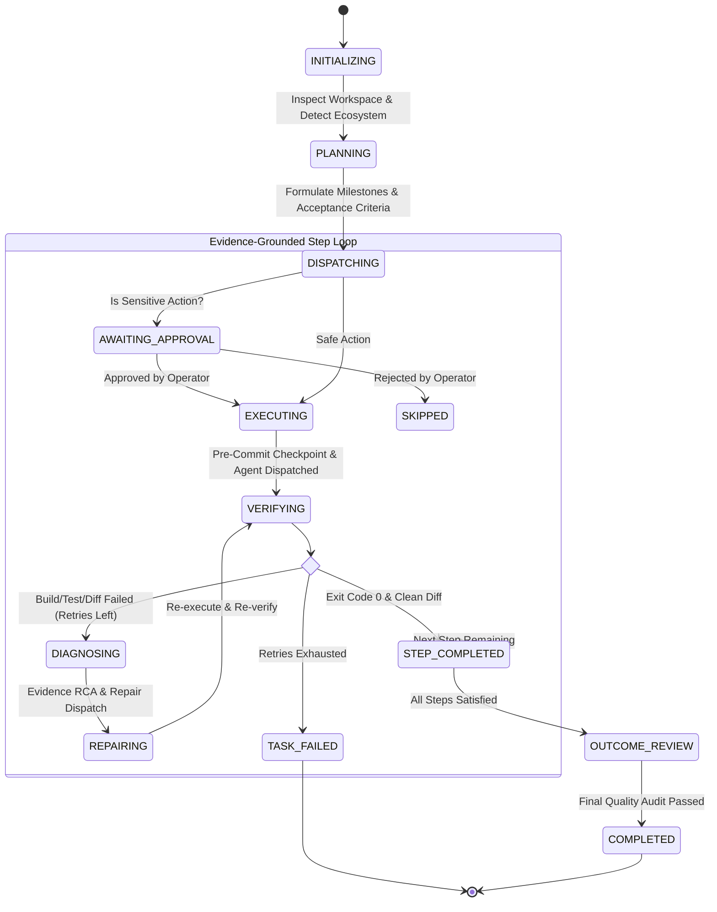

# Autonomous AI Coding Orchestrator

[](https://www.typescriptlang.org/)
[](https://nodejs.org/)
[](https://fastify.dev/)
[](https://turso.tech/libsql)
[](https://vitejs.dev/)
[](https://react.dev/)
[](https://ai.google.dev/)
[](LICENSE)

An enterprise-grade, local-first closed-loop engineering platform that connects an LLM (**The Brain**) with a coding agent (**The Engineer**) and an independent verification engine (**The Verifier**), coordinated by a deterministic state machine (**The Orchestrator**).

> **Core Axiom**: The system never assumes a task is complete merely because an AI agent reports success. Completion must be supported by empirical execution results, isolated test assertions, and cryptographically tracked Git diff evidence.

---

## 📑 Table of Contents

- [The Evidence-Driven Engineering Contract](#-the-evidence-driven-engineering-contract)
- [Empirical Evidence Verification Matrix](#-empirical-evidence-verification-matrix)
- [Verifiable Execution Audit Trail (Actual Case Study)](#-verifiable-execution-audit-trail-actual-case-study)
- [Architectural Philosophy](#-architectural-philosophy)
- [System Architecture](#-system-architecture)
- [The Closed-Loop Lifecycle & State Machine](#-the-closed-loop-lifecycle--state-machine)
- [Subsystem Deep Dive](#-subsystem-deep-dive)
  - [1. The Brain (`src/llm`)](#1-the-brain-srcllm)
  - [2. The Engineer (`src/agent`)](#2-the-engineer-srcagent)
  - [3. The Independent Verifier (`src/verifier`)](#3-the-independent-verifier-srcverifier)
  - [4. The State Engine & Durable Ledger (`src/orchestrator` & `src/db`)](#4-the-state-engine--durable-ledger-srcorchestrator--srcdb)
  - [5. Repository & Checkpoint Service (`src/repo`)](#5-repository--checkpoint-service-srcrepo)
- [Extensibility & Custom Adapters](#-extensibility--custom-adapters)
  - [Implementing a Custom Coding Agent](#implementing-a-custom-coding-agent)
  - [Plugging in Alternative LLM Providers](#plugging-in-alternative-llm-providers)
- [Developer Setup & Local Development](#-developer-setup--local-development)
- [REST & WebSocket API Specification](#-rest--websocket-api-specification)
  - [REST Endpoints](#rest-endpoints)
  - [WebSocket Realtime Event Stream](#websocket-realtime-event-stream)
- [CLI Reference](#-cli-reference)
- [Programmatic Library Usage](#-programmatic-library-usage)
- [Security Model & Invariants](#-security-model--invariants)
- [Contributing & Testing](#-contributing--testing)
- [License](#-license)

---

## ⚖️ The Evidence-Driven Engineering Contract

In typical autonomous coding agents, the system asks the LLM: *"Did you finish the task?"* and the LLM responds: *"Yes, I implemented everything perfectly!"*. This is the **Confirmation Bias Fallacy**.

The **Autonomous AI Coding Orchestrator** replaces self-reported claims with a three-tier hierarchical **Evidence Model**:

```
                       +-------------------------------------------------------+
                       |           TIER 3: INDEPENDENTLY VERIFIED              |
                       |  - Subprocess Exit Code 0 (Compilers & Test Runners)   |
                       |  - Clean Git Diff Invariant (No Test Skipping / Bypasses)|
                       |  - Recorded in SQLite Ledger & Emitted via Event Stream |
                       +---------------------------+---------------------------+
                                                   ^
                                                   | Promoted only upon empirical proof
                       +---------------------------+---------------------------+
                       |               TIER 2: IMPLEMENTED WORK                |
                       |  - Discrete Files Modified on Disk                    |
                       |  - Cryptographic Git Commit Checkpoints (SHA-1)       |
                       |  - Parsed Staged & Unstaged Diff Trees                |
                       +---------------------------+---------------------------+
                                                   ^
                                                   | Code applied to workspace
                       +---------------------------+---------------------------+
                       |                TIER 1: ATTEMPTED WORK                 |
                       |  - Agent Thought Chains & Tool Invocations            |
                       |  - Shell Command Execution Requests                   |
                       |  - Raw Terminal Stdout / Stderr Streams               |
                       |  * (Treated strictly as unverified hypotheses)       |
                       +-------------------------------------------------------+
```

### The 4 Pillars of the Evidence Contract

1. **Non-Repudiation**: Every file change is bracketed by Git commit snapshots (`pre-step` and `post-step`), generating an unforgeable hash audit trail.
2. **Subprocess Isolation**: Builds and tests are run in isolated OS processes (`powershell.exe` / `/bin/bash`), bypassing the LLM's own context window.
3. **Anti-Tamper Heuristics**: The diff auditor inspects code modifications for deceptive tactics, such as commenting out test assertions or injecting `test.skip` / `it.skip` / `@pytest.mark.skip`.
4. **Evidence-Grounded RCA**: When a check fails, the Brain does not guess. It receives the raw, unedited compiler stack trace and diff patch to perform deterministic Root Cause Analysis.

---

## 📊 Empirical Evidence Verification Matrix

| Dimension | Verification Mechanism | Success Evidence Criteria | Failure Detection |
| :--- | :--- | :--- | :--- |
| **Compilation** | Independent Build Subprocess (`npm run build`, `tsc`, `cargo build`) | Process `exitCode === 0` | Syntax errors, missing imports, type mismatches |
| **Functionality** | Test Runner (`npm test`, `vitest`, `pytest`, `cargo test`) | Process `exitCode === 0` + Zero failing test assertions | Assertion failures, runtime exceptions, timeouts |
| **Code Quality** | Static Analyzer / Linter (`eslint`, `ruff`, `clippy`) | Clean linter run or zero fatal diagnostic warnings | Linter violations, unhandled promises, memory leaks |
| **Integrity** | Git Diff Heuristic Scanner | Diff does not introduce test-skipping patterns | Insertion of `test.skip`, `it.skip`, bypasses |
| **Security** | File Path Boundary & Secret Scanner | Zero modifications to `.env`, private keys, or system files | Unauthorized access outside workspace root |
| **State Snapshot** | Git Checkpoint Hash | Generated `commitHash` stored in durable SQLite ledger | Dirty uncommitted state, merge conflict |

---

## 🔍 Verifiable Execution Audit Trail (Actual Case Study)

Below is an actual, unedited evidence record captured from the system's durable SQLite ledger during an automated task run:

### 1. Task Ledger Record (`tasks`)
```json
{
  "id": "14dce10a-fd08-4a28-8aff-8c9a484a253b",
  "title": "Test Math Module",
  "prompt": "Create math utility functions add and multiply in src/utils/math.ts and verify build passes",
  "workspacePath": "C:\\Users\\nsrfl\\OneDrive\\Desktop\\oRCHESTRATOR",
  "status": "COMPLETED",
  "retryCount": 0,
  "maxRetries": 3,
  "summary": "All execution steps finished and verification checks passed.",
  "createdAt": "2026-10-27T20:56:28.645Z",
  "completedAt": "2026-10-27T20:56:37.055Z"
}
```

### 2. Independent Verification Audit Record (`verifications`)
```json
{
  "id": "17e8708e-bd74-4829-b819-d6800493d377",
  "taskId": "14dce10a-fd08-4a28-8aff-8c9a484a253b",
  "status": "PASSED",
  "buildStatus": "PASSED",
  "testStatus": "PASSED",
  "lintStatus": "PASSED",
  "diffInspection": "Changed 0 files cleanly.",
  "details": {
    "overallPassed": true,
    "buildCheck": {
      "passed": true,
      "command": "npm.cmd run build",
      "output": "> orchestrator@1.0.0 build\n> tsc",
      "exitCode": 0
    },
    "testCheck": {
      "passed": true,
      "command": "npm.cmd test",
      "output": "> orchestrator@1.0.0 test\n> echo \"Ready for orchestrator tests\"\n\n\"Ready for orchestrator tests\"",
      "exitCode": 0
    },
    "diffAudit": {
      "filesChanged": [],
      "hasSuspiciousDeletions": false,
      "hasForbiddenModifications": false,
      "summary": "Changed 0 files cleanly."
    },
    "diagnostics": ""
  },
  "createdAt": "2026-10-27T20:56:36.631Z"
}
```

### 3. Cryptographic Git Commit Checkpoint Timeline
```
* 182d36c - post-step-3: Run Tests & Self-Verification (Verified exit code 0)
* 1621cf2 - pre-step-3: Run Tests & Self-Verification (Baseline snapshot)
* a25544e - post-step-2: Implement Core Feature / Fix (Verified build pass)
* 87c8f00 - pre-step-2: Implement Core Feature / Fix (Baseline snapshot)
* 76d4891 - post-step-1: Inspect & Set Up Environment (Environment validated)
* feaadb9 - docs: add MIT License
* 116db6a - feat: complete initial Autonomous AI Coding Orchestrator
```

Every checkpoint can be rolled back to instantly:
```bash
git checkout 1621cf2
```

---

## 💡 Architectural Philosophy

The **Autonomous AI Coding Orchestrator** decouples **Intent** from **Execution** and **Empirical Validation**:
- **Cognition ≠ Execution**: The Brain (`LLMBrain`) plans milestones and performs Root Cause Analysis (RCA), but never writes directly to disk.
- **Execution ≠ Verification**: The Agent (`BuiltInAutonomousAgent`) executes edits and tools, but its self-reported success is **untrusted data**.
- **Empirical Ground Truth**: The Verifier (`IndependentVerifier`) executes builds, test suites, and git diff audits outside the agent's context. A step is only marked `COMPLETED` when exit codes equal `0` and diff invariants hold.

---

## 🏛 System Architecture

```
                             +-------------------------------+
                             |    Developer / CLI / Web UI   |
                             +---------------+---------------+
                                             | HTTP / WS
                                             v
                             +-------------------------------+
                             |      Fastify Server Gateway   |
                             |  - REST Dispatcher            |
                             |  - WebSocket Event Pool       |
                             +---------------+---------------+
                                             |
                                             v
+-----------------------------------------------------------------------------------------+
|                                    ORCHESTRATION ENGINE                                 |
|                                                                                         |
|   +-----------------------+     +-------------------------+     +-------------------+   |
|   | SQLite Durable Ledger | <-> | State Machine & Retries | <-> | Human Gatekeeper  |   |
|   | (Tasks/Steps/Reports) |     | (Timeout & Loop Guards) |     | (Sensitive Steps) |   |
|   +-----------------------+     +-------------------------+     +-------------------+   |
+-------------------+----------------------------+----------------------------+-----------+
                    |                            |                            |
                    v                            v                            v
      +---------------------------+ +---------------------------+ +-----------------------+
      |      THE BRAIN (LLM)      | |   THE ENGINEER (AGENT)    | | INDEPENDENT VERIFIER  |
      | - Plan Decomposer         | | - Tool Loop (read/write)  | | - Native Build Runner |
      | - Diagnostic RCA Engine   | | - Regex & AST Search      | | - Test Suite Runner   |
      | - Objective Reviewer      | | - Sandbox Shell Exec      | | - Diff Invariant Audit|
      +---------------------------+ +---------------------------+ +-----------------------+
                    ^                            |                            |
                    |      Failure Diagnostics   | Actual Modifications       |
                    +----------------------------+----------------------------+
                                                 |
                                                 v
                                   +---------------------------+
                                   |    Target Repository      |
                                   |  - Git Checkpoint Commits |
                                   |  - Isolated File Trees    |
                                   +---------------------------+
```

---

## 🔄 The Closed-Loop Lifecycle & State Machine



---

## 🔬 Subsystem Deep Dive

### 1. The Brain (`src/llm`)
- **Engine**: Powered by Google Gemini (`@google/genai`) using Gemini 3.8 / 2.5 Flash / Pro.
- **Contract Schemas**:
  - `generatePlan()`: Ingests repository metadata, language ecosystem, detected build/test commands, and user prompt. Outputs structured JSON conforming to `ExecutionPlan`.
  - `diagnoseFailure()`: Takes empirical evidence (terminal stderr, test trace, git diff), performs Root Cause Analysis (RCA), and outputs targeted repair directives without hallucinations.
  - `reviewOutcome()`: Audits final diff against the original acceptance criteria and produces an empirical confidence score (0-100).

### 2. The Engineer (`src/agent`)
- **Interface**: `CodingAgent` contract requiring `executeStep(instruction, targetFiles)`.
- **BuiltInAutonomousAgent**: Iterative tool-calling runtime with local safety boundaries:
  - `readFile(path)`: Safe read within workspace bounds.
  - `writeFile(path, content)`: Creates parent directories and writes atomic content.
  - `replaceInFile(path, target, replacement)`: Surgical string replacement.
  - `deleteFile(path)`: Controlled file deletion.
  - `listFiles(relDir)`: Non-recursive and recursive file tree scanner.
  - `searchCode(regexQuery)`: Ripgrep-style in-memory file search.
  - `executeCommand(cmd, timeoutMs)`: Spawned subprocess under PowerShell / Bash with timeout handling.

### 3. The Independent Verifier (`src/verifier`)
- **Build Verifier**: Runs auto-detected compilation pipelines (`npm run build`, `cargo build`, `go build`).
- **Test Runner**: Runs test suites (`npm test`, `pytest`, `cargo test`) and captures exit codes and stack traces.
- **Diff & Invariant Auditor**:
  - Detects banned test bypassing (e.g., `test.skip`, `it.skip`, `@pytest.mark.skip`).
  - Guards protected files from unauthorized tampering (`.env`, private keys, protected configs).

### 4. The State Engine & Durable Ledger (`src/orchestrator` & `src/db`)
- **Durable Persistence**: Backed by LibSQL (`file:orchestrator.db`). Survives process restarts and crashes.
- **Evidence Ledger Schema**:
  - `tasks`: Root record containing state, retry budgets, prompt, and final review summary.
  - `steps`: Atomic steps with execution logs, tools invoked, and diff snapshots.
  - `verifications`: Complete verification logs, status per check, and RCA diagnostics.
  - `checkpoints`: Git commit hashes before and after every step for rollback support.
  - `approvals`: Suspended actions awaiting human interaction.

### 5. Repository & Checkpoint Service (`src/repo`)
- Powered by `simple-git`.
- Automatically initializes git repositories if none exist.
- Performs atomic checkpoint commits:
  - `pre-step-<index>: <step_title>`
  - `post-step-<index>: <step_title>`
- Supports one-click hard rollback: `inspector.rollbackToCommit(commitHash)`.

---

## 🔌 Extensibility & Custom Adapters

### Implementing a Custom Coding Agent
You can replace or wrap the built-in agent with external CLI agents like **Aider**, **Claude Code**, or a custom sandbox:

```typescript
import { type CodingAgent, type StepExecutionResult } from './src/agent/index.js';

export class CustomDockerAgent implements CodingAgent {
  name = 'CustomDockerAgent';

  async executeStep(instruction: string, targetFiles: string[] = []): Promise<StepExecutionResult> {
    // 1. Dispatch instruction into an isolated container
    // 2. Collect stdout/stderr and modified file diffs
    return {
      agentName: this.name,
      success: true,
      logs: 'Executed inside Docker container',
      toolsUsed: ['docker:run'],
      exitCode: 0,
    };
  }
}

// Pass to the orchestrator:
await orchestrator.runTask({
  prompt: 'Add JWT authentication',
  workspacePath: '/path/to/project',
  customAgent: new CustomDockerAgent(),
});
```

### Plugging in Alternative LLM Providers
The LLM Brain is structured around standard schemas. To plug in Anthropic Claude, OpenAI, or local Ollama instances, implement the planner and diagnostic interfaces in `src/llm/index.ts`.

---

## 🛠 Developer Setup & Local Development

### Prerequisites
- Node.js `v20.x` or `v24.x`
- Git `2.40+`
- PowerShell (Windows) or Bash (macOS/Linux)

### 1. Clone & Install Dependencies
```bash
git clone https://github.com/MokuLakshithReddy/autonomous-ai-coding-orchestrator.git
cd autonomous-ai-coding-orchestrator

# Install backend dependencies
npm install

# Install web dashboard dependencies
cd web
npm install
cd ..
```

### 2. Environment Configuration
Create your `.env` file:
```bash
cp .env.example .env
```
Fill in your configuration:
```env
# Google Gemini API Key (Get one from https://aistudio.google.com/)
GEMINI_API_KEY=your_gemini_api_key_here
GEMINI_MODEL=gemini-2.5-flash

# Orchestrator Server Settings
PORT=4000
HOST=127.0.0.1
DATABASE_URL=file:orchestrator.db
MAX_RETRY_BUDGET=3
STEP_TIMEOUT_SECONDS=300
AUTO_REPAIR_ENABLED=true
REQUIRE_APPROVAL_FOR_DESTRUCTIVE=true
```

### 3. Running in Development Mode
Run backend and frontend concurrently with hot-reloading:

```bash
# Terminal 1: Backend Watch Mode
npm run dev

# Terminal 2: Web Dashboard Dev Server
cd web
npm run dev
```

### 4. Production Build & Execution
```bash
# Compile backend TypeScript and build Vite production bundle
npm run build
cd web && npm run build && cd ..

# Start the unified server (serves API, WebSockets, and Web UI on port 4000)
npm start
```
Navigate to **`http://localhost:4000`** in your browser.

---

## 📡 REST & WebSocket API Specification

### REST Endpoints

| Method | Endpoint | Description | Payload Example |
| :--- | :--- | :--- | :--- |
| `GET` | `/api/system/status` | System health & LLM model status | — |
| `POST` | `/api/config/gemini` | Dynamically update API key/model | `{ "apiKey": "...", "model": "gemini-2.5-flash" }` |
| `POST` | `/api/repo/inspect` | Inspect ecosystem & detection suites | `{ "workspacePath": "C:/projects/app" }` |
| `GET` | `/api/tasks` | List historical and active tasks | — |
| `POST` | `/api/tasks` | Dispatch a new autonomous task | `{ "prompt": "...", "workspacePath": "...", "maxRetries": 3 }` |
| `GET` | `/api/tasks/:id` | Fetch task details, steps, verifications | — |
| `POST` | `/api/tasks/:id/cancel` | Cancel an in-flight task | — |
| `POST` | `/api/approvals/:id/respond`| Human approval response | `{ "status": "APPROVED" \| "REJECTED" }` |

### WebSocket Realtime Event Stream
Connect to `ws://localhost:4000/ws` to receive live JSON event streams:

```typescript
interface OrchestratorEvent {
  id: string;
  taskId: string;
  stepId?: string;
  type: 
    | 'TASK_CREATED'
    | 'REPO_INSPECTED'
    | 'PLAN_GENERATED'
    | 'STEP_STARTED'
    | 'APPROVAL_REQUIRED'
    | 'APPROVAL_RESOLVED'
    | 'STEP_EXECUTED'
    | 'STEP_VERIFYING'
    | 'VERIFICATION_PASSED'
    | 'VERIFICATION_FAILED'
    | 'DIAGNOSING_ERROR'
    | 'REPAIR_ATTEMPT'
    | 'STEP_COMPLETED'
    | 'TASK_COMPLETED'
    | 'TASK_FAILED'
    | 'TASK_BLOCKED';
  message: string;
  data?: any;
  timestamp: string;
}
```

---

## 💻 CLI Reference

The CLI provides full autonomous execution capabilities directly in your terminal:

```bash
# Run an autonomous task in the current directory:
npm run cli -- run -p "Implement health check endpoint and verify tests"

# Run in an external repository workspace with custom retry budget:
npm run cli -- run -p "Fix JWT expiration bug" -w "C:/workspace/my-api" -r 5

# Inspect repository ecosystem and detected verification suites:
npm run cli -- inspect -w "."

# Start the API and WebSocket server on a custom port:
npm run cli -- serve -p 8080 -h 0.0.0.0
```

---

## 📦 Programmatic Library Usage

You can import the orchestrator directly as a TypeScript library:

```typescript
import { OrchestrationEngine, RepoInspector } from './src/index.js';

const engine = new OrchestrationEngine();

// Subscribe to live events
engine.on('event', (event) => {
  console.log(`[${event.type}] ${event.message}`);
});

// Run an autonomous task programmatically
const task = await engine.runTask({
  prompt: 'Build a rate limiting middleware with unit tests',
  workspacePath: process.cwd(),
  maxRetries: 3,
});
```

---

## 🛡 Security Model & Invariants

| Guard | Mechanism | Failure Action |
| :--- | :--- | :--- |
| **Path Sandboxing** | `AgentToolbox.resolveSafePath()` checks against `path.resolve(workspacePath)` | Throws `Security Exception`, blocks write |
| **Command Blacklist** | Regex interceptor blocks `rm -rf /`, `format`, `shutdown`, `git push --force` | Rejects subprocess spawn immediately |
| **Protected Branches** | Git service blocks direct pushes to `main`, `master`, `production` | Enforces feature branch creation |
| **Secret Protection** | Verifier flags modifications to `.env`, credentials, or private keys | Fails verification immediately |
| **Infinite Loop Guard**| Max retry budget + step execution timeouts (default 300s) | Halts step, triggers `TASK_BLOCKED` state |
| **Human-in-the-Loop** | Sensitive milestones marked `isSensitive` pause execution | Waits for operator approval via UI / API |

---

## 🧪 Contributing & Testing

1. Fork the repository.
2. Create your feature branch (`git checkout -b feat/docker-sandbox`).
3. Ensure typecheck and tests pass:
   ```bash
   npm run build
   npm test
   ```
4. Commit your changes (`git commit -m "feat: add docker sandbox agent adapter"`).
5. Push to the branch (`git push origin feat/docker-sandbox`).
6. Open a Pull Request.

---

## 📄 License

This project is licensed under the [MIT License](LICENSE) — see the [LICENSE](LICENSE) file for details.
