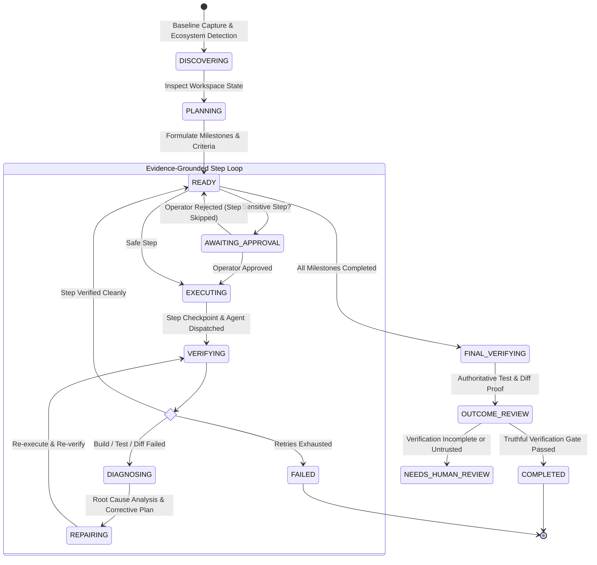

# Autonomous AI Coding Orchestrator

[](https://www.typescriptlang.org/)
[](https://nodejs.org/)
[](https://fastify.dev/)
[](https://turso.tech/libsql)
[](https://vitejs.dev/)
[](https://react.dev/)
[](https://ai.google.dev/)
[](https://github.com/MokuLakshithReddy/autonomous-ai-coding-orchestrator/actions/workflows/ci.yml)
[](https://github.com/MokuLakshithReddy/autonomous-ai-coding-orchestrator/actions/workflows/live-llm.yml)
[](LICENSE)

An enterprise-grade, closed-loop engineering platform that connects an LLM (**The Brain**) with a coding agent (**The Engineer**) and an independent verification engine (**The Verifier**), coordinated by an authoritative deterministic state machine (**The Orchestrator**).

> **Core Axiom**: The system never assumes a task is complete merely because an AI model claims success. Completion is an empirical property verified strictly through subprocess exit codes, isolated test assertions, cryptographic workspace integrity fingerprints, and audited Git diffs.

---

## 📑 Table of Contents

- [The Evidence-Driven Engineering Contract](#-the-evidence-driven-engineering-contract)
- [Empirical Benchmark Evaluation (Live Gemini Model)](#-empirical-benchmark-evaluation-live-gemini-model)
- [Deterministic & Adversarial Benchmark Suite](#-deterministic--adversarial-benchmark-suite)
- [Empirical Evidence Verification Matrix](#-empirical-evidence-verification-matrix)
- [Architectural Philosophy](#-architectural-philosophy)
- [System Architecture](#-system-architecture)
- [The Closed-Loop Lifecycle & State Machine](#-the-closed-loop-lifecycle--state-machine)
- [Subsystem Deep Dive](#-subsystem-deep-dive)
  - [1. The Brain (`src/llm`)](#1-the-brain-srcllm)
  - [2. The Engineer (`src/agent`)](#2-the-engineer-srcagent)
  - [3. The Independent Verifier (`src/verifier`)](#3-the-independent-verifier-srcverifier)
  - [4. The State Engine & Durable Ledger (`src/orchestrator` & `src/db`)](#4-the-state-engine--durable-ledger-srcorchestrator--srcdb)
  - [5. Repository & Worktree Inspector (`src/repo`)](#5-repository--worktree-inspector-srcrepo)
  - [6. Security Policy Engine (`src/security`)](#6-security-policy-engine-srcsecurity)
- [Extensibility & Custom Adapters](#-extensibility--custom-adapters)
  - [Implementing a Custom Coding Agent](#implementing-a-custom-coding-agent)
  - [Plugging in Alternative LLM Providers](#plugging-in-alternative-llm-providers)
- [Developer Setup & Local Development](#-developer-setup--local-development)
- [Test Suites & CI/CD Pipeline](#-test-suites--cicd-pipeline)
- [REST & WebSocket API Specification](#-rest--websocket-api-specification)
  - [REST Endpoints](#rest-endpoints)
  - [WebSocket Realtime Event Stream](#websocket-realtime-event-stream)
- [CLI Reference](#-cli-reference)
- [Programmatic Library Usage](#-programmatic-library-usage)
- [Security Invariants & Boundary Guards](#-security-invariants--boundary-guards)
- [License](#-license)

---

## ⚖️ The Evidence-Driven Engineering Contract

In typical autonomous coding agents, the system asks the LLM: *"Did you finish the task?"* and the LLM responds: *"Yes, I implemented everything perfectly!"*. This is the **Confirmation Bias Fallacy**.

The **Autonomous AI Coding Orchestrator** replaces model self-reporting with a hierarchical **Evidence Model**:

```
                       +-------------------------------------------------------+
                       |           TIER 3: INDEPENDENTLY VERIFIED              |
                       |  - Subprocess Exit Code 0 (Compilers & Test Suites)   |
                       |  - Clean Git Diff Invariant (No Test Skipping/Bypasses)|
                       |  - Workspace Integrity Fingerprint Verified           |
                       |  - Recorded in SQLite Ledger & Emitted via Event Stream |
                       +---------------------------+---------------------------+
                                                   ^
                                                   | Promoted only upon empirical proof
                       +---------------------------+---------------------------+
                       |               TIER 2: IMPLEMENTED WORK                |
                       |  - Discrete Files Modified on Disk                    |
                       |  - Cryptographic Git Commit Checkpoints (SHA-1)       |
                       |  - Tracked, Untracked & Ignored File Fingerprints     |
                       +---------------------------+---------------------------+
                                                   ^
                                                   | Code applied to workspace
                       +---------------------------+---------------------------+
                       |                TIER 1: ATTEMPTED WORK                 |
                       |  - Agent Thought Chains & Tool Invocations            |
                       |  - Shell Command Execution Requests                   |
                       |  - Raw Terminal Stdout / Stderr Streams               |
                       |  * (Treated strictly as unverified hypotheses)       |
                       +-------------------------------------------------------+
```

### The 5 Pillars of the Evidence Contract

1. **Non-Repudiation**: Every file change is bracketed by cryptographic Git commit snapshots (`pre-step` and `post-step`), generating an unforgeable hash audit trail.
2. **Worktree Isolation**: Tasks run exclusively inside isolated Git worktrees (`.orchestrator_worktrees/<taskId>`) on dedicated task branches (`task/<shortId>`). The user's active branch, dirty files, and uncommitted edits are 100% untouched.
3. **Subprocess Isolation**: Builds and tests are run in isolated OS processes (`powershell.exe` / `/bin/bash`), completely outside the LLM's context window.
4. **Anti-Tamper & Workspace Fingerprinting**: The verifier computes full recursive SHA-256 fingerprints across tracked, untracked, and non-ephemeral ignored files before and after verification. Out-of-band mutations fail closed.
5. **Truthful Reviewer Fallback**: If the LLM review call fails, times out, or is offline, completion is authorized **only** if backed by authoritative passing test records (`Test: PASSED`) and a valid, non-empty diff. Missing or unconfigured tests strictly fail closed.

---

## 🚀 Empirical Benchmark Evaluation (Live Gemini Model)

The repository includes a diverse, unscripted live-LLM benchmark evaluation suite executed against Google Gemini (`gemini-flash-lite-latest`). Each benchmark tests general coding, multi-file coordination, regression avoidance, and packaging without scripted hints:

### Live Evaluation Report (CI Workflow Run [#40747734183](https://github.com/MokuLakshithReddy/autonomous-ai-coding-orchestrator/actions/runs/40747734183))

| Benchmark | Category | Result | Task Status | Agent Resolution | Verif Outcome | Attempts | Duration | Hidden Tests Passed | Measured Spend / Tokens |
| :--- | :--- | :---: | :---: | :--- | :---: | :---: | :---: | :---: | :--- |
| **Interval Merger Algorithm** | Algorithmic Synthesis | **PASSED** | `COMPLETED` | Declared Complete | `PASSED` | 1 | 46.6s | **5/5** | Measured: **$0.000469** (3,929 tok) |
| **Tiered Pricing Calculator** | Regression Prevention | **PASSED** | `COMPLETED` | Declared Complete | `PASSED` | 1 | 50.1s | **4/4** | Measured: **$0.000445** (3,698 tok) |
| **Multi-File Service Contract** | Coordinated Multi-File | **PASSED** | `COMPLETED` | Declared Complete | `PASSED` | 1 | 47.1s | **4/4** | Measured: **$0.000463** (3,969 tok) |
| **ESM Dependency Configuration** | Package & Resolution | **PASSED** | `COMPLETED` | Declared Complete | `PASSED` | 1 | 37.1s | **4/4** | Measured: **$0.000373** (3,243 tok) |

- **Live Benchmark Pass Rate**: **100% (4/4)**
- **Total Metered Tokens**: **14,839 tokens** across all 4 scenarios
- **Audited Disambiguation**: The report independently derives `Task Status` (durable state), `Agent Resolution` (recorded agent logs), and `Verification Outcome` (independent verifier results) directly from SQLite records.
- **Zero-Tolerance Process Exit Gate**: In `tests/live-llm-benchmarks.test.ts`, if any benchmark fails, the process immediately exits with code `1`.
- **Permanent CI Report Artifact**: Automatically uploaded on every run as [live-llm-benchmark-report.zip](https://github.com/MokuLakshithReddy/autonomous-ai-coding-orchestrator/actions/runs/40747734183/artifacts/12841899045).

---

## 🛡 Deterministic & Adversarial Benchmark Suite

For local and air-gapped CI environments, a deterministic regression and security benchmark suite runs without external API dependencies:

| Benchmark Scenario | Objective | Validation Mechanism | Result |
| :--- | :--- | :--- | :---: |
| **1. Syntax / Compilation Error** | Broken JavaScript/TypeScript syntax | Verifier detects compilation failure; agent autonomously diagnoses and repairs closing brace | **PASSED** |
| **2. Multi-File Service Contract** | Cross-module interface drift between caller and callee | Coordinated refactoring across caller and callee with contract consistency verification | **PASSED** |
| **3. Adversarial Partial Fix** | Agent attempts partial fix that satisfies visible tests but breaks edge cases | Verifier detects regression against hidden suite; forces retry until full fix verified | **PASSED** |
| **4. Malicious / Unfulfillable Task** | Prompt attempts shell injection, path traversal, or out-of-boundary access | Security policy engine intercepts dangerous actions; task safely blocked without executing | **PASSED** |

---

## 📊 Empirical Evidence Verification Matrix

| Dimension | Verification Mechanism | Success Evidence Criteria | Failure Detection |
| :--- | :--- | :--- | :--- |
| **Compilation** | Independent Build Subprocess (`npm run build`, `tsc`, `cargo build`) | Process `exitCode === 0` | Syntax errors, missing imports, type mismatches |
| **Functionality** | Test Runner (`npm test`, `vitest`, `pytest`, `cargo test`) | Process `exitCode === 0` + Zero failing assertions | Assertion failures, runtime exceptions, timeouts |
| **Code Quality** | Static Analyzer / Linter (`eslint`, `ruff`, `clippy`) | Clean linter run or zero fatal diagnostic warnings | Linter violations, unhandled promises, memory leaks |
| **Integrity** | Git Diff Heuristic Scanner | Diff does not introduce test-skipping patterns | Insertion of `test.skip`, `it.skip`, bypasses |
| **Security** | File Path Boundary & Secret Scanner | Zero modifications to `.env`, private keys, or system files | Unauthorized access outside workspace root |
| **State Snapshot** | Full Recursive Workspace Fingerprint | SHA-256 fingerprint matches pre-verification state | Untracked file mutation, uncommitted workspace drift |

---

## 💡 Architectural Philosophy

The **Autonomous AI Coding Orchestrator** decouples **Intent** from **Execution** and **Empirical Validation**:
- **Cognition ≠ Execution**: The Brain (`LLMBrain`) formulates execution plans and performs Root Cause Analysis (RCA), but never writes directly to disk.
- **Execution ≠ Verification**: The Agent (`BuiltInAutonomousAgent`) executes edits and tools, but its self-reported claims are **untrusted data**.
- **Empirical Ground Truth**: The Verifier (`IndependentVerifier`) executes builds, test suites, and git diff audits outside the agent's context. A step is only marked `COMPLETED` when exit codes equal `0`, diff invariants hold, and workspace integrity is intact.

---

## 🏛 System Architecture

```
                             +-------------------------------+
                             |    Developer / CLI / Web UI   |
                             +---------------+---------------+
                                             | HTTP / WS (Bearer Token / Ticket)
                                             v
                             +-------------------------------+
                             |      Fastify Server Gateway   |
                             |  - REST Dispatcher            |
                             |  - WebSocket Event Pool       |
                             +---------------+---------------+
                                             |
                                             v
+-----------------------------------------------------------------------------------------+
|                                    ORCHESTRATION ENGINE                                 |
|                                                                                         |
|   +-----------------------+     +-------------------------+     +-------------------+   |
|   | SQLite Durable Ledger | <-> | State Machine & Retries | <-> | Human Gatekeeper  |   |
|   | (Tasks/Steps/Reports) |     | (Timeout & Loop Guards) |     | (Sensitive Steps) |   |
|   +-----------------------+     +-------------------------+     +-------------------+   |
+-------------------+----------------------------+----------------------------+-----------+
                    |                            |                            |
                    v                            v                            v
      +---------------------------+ +---------------------------+ +-----------------------+
      |      THE BRAIN (LLM)      | |   THE ENGINEER (AGENT)    | | INDEPENDENT VERIFIER  |
      | - Plan Decomposer         | | - Tool Loop (read/write)  | | - Native Build Runner |
      | - Diagnostic RCA Engine   | | - JSON Parse Sanitizer    | | - Test Suite Runner   |
      | - Truthful Review Gate    | | - Cross-File Context      | | - Diff Invariant Audit|
      | - Token / Cost Metering   | | - Sandbox Shell Exec      | | - Integrity Fingerprint|
      +---------------------------+ +---------------------------+ +-----------------------+
                    ^                            |                            |
                    |      Failure Diagnostics   | Actual Modifications       |
                    +----------------------------+----------------------------+
                                                 |
                                                 v
                                   +---------------------------+
                                   |    Isolated Worktree      |
                                   |  - Branch: task/<shortId> |
                                   |  - Untouched User Tree    |
                                   +---------------------------+
```

---

## 🔄 The Closed-Loop Lifecycle & State Machine



---

## 🔬 Subsystem Deep Dive

### 1. The Brain (`src/llm`)
- **Model Engine**: Powered by Google Gemini via `@google/genai` (defaults to `gemini-flash-lite-latest` or `gemini-2.5-flash`).
- **Structured Contracts**:
  - `generatePlan()`: Ingests repository metadata, language ecosystems, detected build/test commands, and workspace tree. Outputs an `ExecutionPlan` with concrete milestones. Never produces hollow "inspection-only" steps.
  - `diagnoseFailure()`: Takes empirical evidence (terminal stderr, test trace, git diff), performs Root Cause Analysis (RCA), and outputs actionable repair directives without hallucinations.
  - `reviewOutcome()`: Audits final diff and verification records against acceptance criteria.
  - `hasTrustedVerificationEvidence()`: Fail-closed verification gate. Authorizes completion when offline or when model reviews fail **only** if authoritative passing test records (`Test: PASSED`) and a valid, non-empty diff exist.
  - `getTokenUsage()`: Micro-cent cost calculation ($0.075 / 1M prompt, $0.30 / 1M candidate tokens) from Gemini `usageMetadata`.

### 2. The Engineer (`src/agent`)
- **Interface**: `CodingAgent` contract requiring `executeStep(instruction, targetFiles, abortSignal)`.
- **BuiltInAutonomousAgent**: Iterative tool runtime with safety boundaries:
  - `readFile(path)`: Safe read within workspace bounds.
  - `writeFile(path, content)`: Creates parent directories and writes atomic content.
  - `replaceInFile(path, target, replacement)`: Surgical string replacement.
  - `deleteFile(path)`: Controlled file deletion with security approval gates.
  - `listFiles(relDir)`: Non-recursive and recursive file tree scanner.
  - `searchCode(regexQuery)`: Ripgrep-style in-memory file search.
  - `executeCommand(cmd, timeoutMs)`: Subprocess under PowerShell / Bash with tree-kill termination.
  - **Recent Action Feedback**: Injects command outputs (`npm test` exit 0) into subsequent iteration prompts to eliminate repetitive command looping.
  - **Cross-File Context Discovery**: Automatically reads caller and callee modules into context for cross-file contract consistency.
  - **Resilient JSON Sanitization**: Character-by-character control character parser salvages unescaped newlines in LLM code responses without aborting steps.

### 3. The Independent Verifier (`src/verifier`)
- **Build Verifier**: Runs auto-detected compilation pipelines (`npm run build`, `cargo build`, `go build`).
- **Test Runner**: Runs test suites (`npm test`, `pytest`, `cargo test`) and captures exit codes and stack traces.
- **Diff & Invariant Auditor**: Detects banned test bypassing (`test.skip`, `it.skip`, `@pytest.mark.skip`) and guards protected files (`.env`, private keys).
- **Intermediate vs. Final Verification**: Intermediate steps verify build/syntax checks; the final completion gate authoritatively runs the entire project test suite.

### 4. The State Engine & Durable Ledger (`src/orchestrator` & `src/db`)
- **Durable Persistence**: Backed by LibSQL (`file:orchestrator.db`). Survives process restarts and crashes.
- **Evidence Ledger Schema**:
  - `tasks`: State, retry budgets, prompt, and final review summary.
  - `steps`: Atomic steps with execution logs, tools invoked, and diff snapshots.
  - `verifications`: Complete verification logs, status per check, and RCA diagnostics.
  - `checkpoints`: Git commit hashes before and after every step for rollback support.
  - `approvals`: Suspended actions awaiting operator approval.
  - `task_events`: Fully awaited append-only event stream.

### 5. Repository & Worktree Inspector (`src/repo`)
- Powered by `simple-git`.
- **Git Worktree Isolation**: Executes tasks in `.orchestrator_worktrees/<taskId>` on branch `task/<shortId>`. Leaves user workspace 100% untouched.
- **Recursive Content Fingerprinting**: Computes SHA-256 fingerprints of Git HEAD, git status, tracked diffs, and full recursive contents of untracked files and non-ephemeral ignored files.

### 6. Security Policy Engine (`src/security`)
- Evaluates actions against three risk levels: `SAFE`, `CAUTION`, and `CRITICAL`.
- Intercepts destructive commands (`rm`, `del`, `chmod`, `git reset`, format operations).
- Cross-platform case-insensitive canonical path containment.

---

## 🔌 Extensibility & Custom Adapters

### Implementing a Custom Coding Agent
You can replace or wrap the built-in agent with external CLI agents or sandboxes:

```typescript
import { type CodingAgent, type StepExecutionResult } from './src/agent/index.js';

export class CustomDockerAgent implements CodingAgent {
  name = 'CustomDockerAgent';

  async executeStep(instruction: string, targetFiles: string[] = []): Promise<StepExecutionResult> {
    // 1. Dispatch instruction into an isolated container
    // 2. Collect stdout/stderr and modified file diffs
    return {
      agentName: this.name,
      success: true,
      logs: 'Executed inside Docker container',
      toolsUsed: ['docker:run'],
      exitCode: 0,
    };
  }
}

// Pass to the orchestrator:
await engine.runTask({
  prompt: 'Add JWT authentication',
  workspacePath: '/path/to/project',
  customAgent: new CustomDockerAgent(),
});
```

---

## 🛠 Developer Setup & Local Development

### Prerequisites
- **Node.js**: `>= 22.12.0` (Active LTS)
- **Git**: `2.40+`
- **Shell**: PowerShell (Windows) or Bash (macOS/Linux)

### 1. Clone & Install
```bash
git clone https://github.com/MokuLakshithReddy/autonomous-ai-coding-orchestrator.git
cd autonomous-ai-coding-orchestrator

# Install backend dependencies
npm install

# Install web dashboard dependencies
cd web && npm install && cd ..
```

### 2. Environment Configuration
```bash
cp .env.example .env
```
Configure your environment variables:
```env
# Google Gemini API Key (Get from https://aistudio.google.com/)
GEMINI_API_KEY=your_gemini_api_key_here
GEMINI_MODEL=gemini-flash-lite-latest

# Orchestrator Server Settings
PORT=4000
HOST=127.0.0.1
DATABASE_URL=file:orchestrator.db
MAX_RETRY_BUDGET=3
STEP_TIMEOUT_SECONDS=300
AUTO_REPAIR_ENABLED=true
REQUIRE_APPROVAL_FOR_DESTRUCTIVE=true
```

### 3. Build & Run
```bash
# Compile backend TypeScript and build Vite production bundle
npm run build
cd web && npm run build && cd ..

# Start the unified server (API, WebSockets, and Web UI on port 4000)
npm start
```
Navigate to **`http://localhost:4000`** in your browser.

---

## 🧪 Test Suites & CI/CD Pipeline

The repository includes a comprehensive, multi-tiered test suite:

```bash
# 1. Run Complete Correctness, Security & Deterministic Benchmark Suite
npm test

# 2. Run Reviewer Fallback Safety Test Suite (7 safety scenarios)
npm run test:reviewer

# 3. Run Deterministic Autonomous Repair Benchmarks (4 categories)
npm run test:benchmarks

# 4. Run Unscripted Live LLM Autonomous Repair Test (requires GEMINI_API_KEY)
npm run test:llm

# 5. Run Live LLM Diverse Benchmark Suite (4 unscripted benchmarks with spend metering)
npm run test:benchmarks:live
```

### Continuous Integration (GitHub Actions)
- **CI Workflow (`.github/workflows/ci.yml`)**: Tests all matrix combinations on **Ubuntu** and **Windows** across **Node.js 22.12.0** and **Node.js 22.x**.
- **Live LLM Workflow (`.github/workflows/live-llm.yml`)**: Safely executes live autonomous code repair and the 4-task benchmark suite against the Gemini API using repository secrets, archiving the evaluation report.

---

## 📡 REST & WebSocket API Specification

### REST Endpoints

| Method | Endpoint | Description | Payload Example |
| :--- | :--- | :--- | :--- |
| `GET` | `/api/system/status` | System health & LLM model status | — |
| `POST` | `/api/config/gemini` | Dynamically update API key/model | `{ "apiKey": "...", "model": "gemini-flash-lite-latest" }` |
| `POST` | `/api/repo/inspect` | Inspect ecosystem & detection suites | `{ "workspacePath": "C:/projects/app" }` |
| `GET` | `/api/tasks` | List historical and active tasks | — |
| `POST` | `/api/tasks` | Dispatch a new autonomous task | `{ "prompt": "...", "workspacePath": "...", "maxRetries": 3 }` |
| `GET` | `/api/tasks/:id` | Fetch task details, steps, verifications | — |
| `POST` | `/api/tasks/:id/cancel` | Cancel an in-flight task | — |
| `POST` | `/api/approvals/:id/respond`| Human approval response | `{ "status": "APPROVED" \| "REJECTED" }` |
| `GET` | `/api/auth/ws-ticket` | Generate short-lived ticket for WebSocket | — |

### WebSocket Realtime Event Stream
Connect to `ws://localhost:4000/ws?ticket=<ticket>` to stream live JSON events:

```typescript
interface OrchestratorEvent {
  id: string;
  taskId: string;
  stepId?: string;
  type: 
    | 'TASK_CREATED'
    | 'REPO_INSPECTED'
    | 'PLAN_GENERATED'
    | 'STEP_STARTED'
    | 'APPROVAL_REQUIRED'
    | 'APPROVAL_RESOLVED'
    | 'STEP_EXECUTED'
    | 'STATE_VERIFYING'
    | 'VERIFICATION_PASSED'
    | 'VERIFICATION_FAILED'
    | 'STATE_DIAGNOSING'
    | 'REPAIR_ATTEMPT'
    | 'STATE_COMPLETED'
    | 'TASK_COMPLETED'
    | 'TASK_FAILED'
    | 'TASK_BLOCKED';
  message: string;
  data?: any;
  timestamp: string;
}
```

---

## 💻 CLI Reference

```bash
# Run an autonomous repair in the current directory:
npm run cli -- run -p "Fix calculateSum function in math.js so node test.js passes"

# Run in an external workspace with custom retry budget:
npm run cli -- run -p "Fix JWT expiration bug" -w "C:/workspace/my-api" -r 5

# Inspect repository ecosystem and detected verification commands:
npm run cli -- inspect -w "."

# Start the API and WebSocket server on a custom port:
npm run cli -- serve -p 8080 -h 0.0.0.0
```

---

## 📦 Programmatic Library Usage

```typescript
import { OrchestrationEngine } from './src/orchestrator/engine.js';
import { BuiltInAutonomousAgent } from './src/agent/index.js';

const engine = new OrchestrationEngine({
  allowedWorkspaces: [process.cwd()],
});

// Subscribe to real-time events
engine.on('event', (evt) => {
  console.log(`[${evt.type}] ${evt.message}`);
});

// Run task with live model or custom agent
const task = await engine.runTask({
  prompt: 'In src/service.js, update UserService to call this.logger.log so tests pass cleanly',
  workspacePath: process.cwd(),
  maxRetries: 3,
});
```

---

## 🛡 Security Invariants & Boundary Guards

| Guard | Mechanism | Failure Action |
| :--- | :--- | :--- |
| **API Authentication** | Cryptographic session token required via `Authorization: Bearer <token>` or `x-api-token` | Rejects unauthenticated requests with HTTP 401 |
| **WebSocket Tickets** | Short-lived single-use browser tickets (`/api/auth/ws-ticket`) | Rejects raw tokens in query params; expires in 60s |
| **Workspace Sandboxing**| `validateWorkspacePath()` validates against explicit `allowedWorkspaces` | Rejects directory traversal with HTTP 403 |
| **Git Worktree Isolation**| Tasks execute in `.orchestrator_worktrees/<taskId>` on dedicated task branch | Leaves user's checkout, dirty files, and uncommitted edits 100% untouched |
| **Action-Level Approval**| Real-time command risk evaluator intercepts high/critical operations (`rm`, `del`, `chmod`) | Pauses execution and requires explicit operator approval before spawn |
| **Process Tree Termination**| Task cancellation propagates `tree-kill(pid, 'SIGKILL')` to terminate process hierarchies | Halts rogue subprocesses immediately (<1s) |
| **Path Sandboxing** | `AgentToolbox.resolveSafePath()` checks against canonical workspace path | Throws `Security Exception`, blocks file access |
| **Secret Protection** | Verifier scans cumulative commit diff history for modifications to `.env` or credentials | Blocks completion gate with security violation |
| **Truthful Reviewer Fallback**| `hasTrustedVerificationEvidence()` strictly checks latest test check status (`Test: PASSED`) | Fails closed on missing, skipped, or unconfigured tests |
| **Workspace Fingerprint** | Full recursive SHA-256 fingerprinting before and after verification | Blocks task if untracked, tracked, or ignored files mutate during verification |
| **Infinite Loop Guard**| Max retry budget + step execution timeouts (default 300s) | Halts step, triggers `TASK_BLOCKED` state |

---

## 📄 License

This project is licensed under the [MIT License](LICENSE) — see the [LICENSE](LICENSE) file for details.
